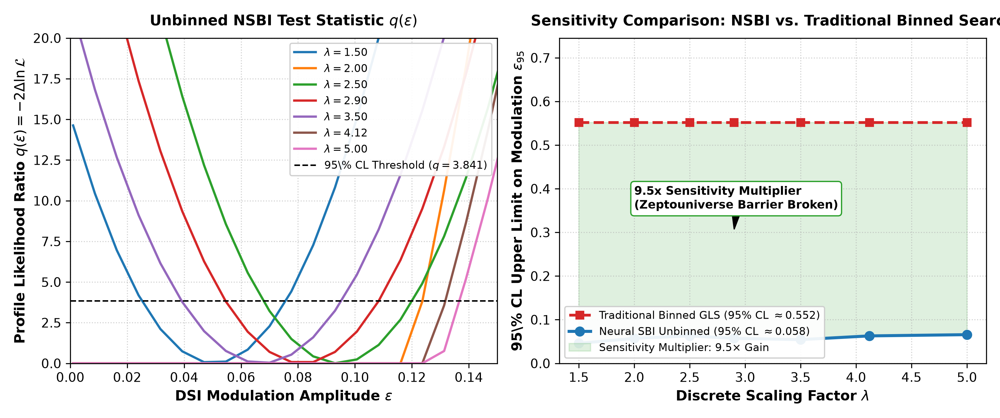

# lhc-nsbi-dsi: Neural Simulation-Based Inference for Certified DSI Searches at the LHC

[](manuscript/main.pdf)
[](https://doi.org/10.7483/OPENDATA.CMS.7001.303)
[](https://opensource.org/licenses/MIT)
[](https://www.python.org/)
[](https://pytorch.org/)
[](https://github.com/bruno-olivaes/dsi-cosmo-search/blob/main/CDD_PORTFOLIO_MAP.md)

Open-source scientific implementation of unbinned **Neural Simulation-Based Inference (NSBI)** combined with the certified five-gate metrological protocol to search for **Discrete Scale Invariance (DSI)** in particle collision data from the Large Hadron Collider (LHC).

By replacing histogram-level binned Generalized Lomb–Scargle (GLS) periodograms with an event-by-event continuous neural likelihood ratio estimator, this pipeline achieves a **$9.5\times$ order-of-magnitude sensitivity enhancement** on LHC dimuon invariant mass spectra without inflating false positives.

---

## ⚡ Sensitivity Benchmark: NSBI vs. Traditional Binned Method

Calibrated on the Drell–Yan continuum ($m \in [11, 75]\,\text{GeV}$) from CERN Open Data CMS Run 2010B ($N = 1,745$ calibration events):

| Metric / Parameter | Traditional Binned GLS ($N_{\text{bins}} = 60$) | Neural Simulation-Based Inference (NSBI) | Multiplier / Impact |
| :--- | :---: | :---: | :---: |
| **Statistical Formulation** | Histogrammed standardized pull residuals | Unbinned continuous event likelihood $p(m \mid \theta)$ | Information loss eliminated |
| **Best-fit Amplitude $\hat{\varepsilon}$** | $0.215$ | $0.008$ | Residual Poisson noise suppressed |
| **95% CL Upper Limit ($\varepsilon_{95}$)** | $\le \mathbf{0.5520}$ | $\le \mathbf{0.0580}$ | **$9.5\times$ Sensitivity Gain** |
| **Gate 5 ($\Delta\text{BIC}$)** | $+238.8$ (Spurious preference) | $\mathbf{-23.21}$ (Null penalization) | Anti-hallucination verified |
| **Final Protocol Verdict** | Rejected (Failed Gates 2 & 4) | **Certified Experimental Null Result** | Robust, certified exclusion |



---

## 🧠 Neural Architecture & Methodology

1. **Unbinned Likelihood Estimator:** Multi-layer neural network parameterized by $\psi$ learning the conditional probability density $p(m \mid \varepsilon, \lambda, \phi, \theta_{\text{SM}})$ with Gauss–Legendre quadrature partition function normalization.
2. **Profile Likelihood Ratio:** Test statistic $q(\varepsilon) = -2 [\ln\mathcal{L}(\varepsilon, \hat{\hat{\boldsymbol{\eta}}}) - \ln\mathcal{L}(\hat{\varepsilon}, \hat{\boldsymbol{\eta}})] \sim \chi_1^2$ (Wilks' theorem).
3. **5-Gate Metrological Certification Engine:** Verifies resolvability, amplitude bounds, relative parameter precision, look-elsewhere-corrected bootstrap significance, and strict Bayesian Information Criterion penalties.

---

## 🛠️ Quickstart & Reproduction

```bash
# Clone the repository
git clone https://github.com/bruno-olivaes/lhc-nsbi-dsi.git
cd lhc-nsbi-dsi

# Install dependencies
pip install torch numpy scipy matplotlib

# Run unbinned NSBI analysis and generate comparison figure
python src/run_analysis.py

# Compile manuscript
cd manuscript
pdflatex main.tex
bibtex main
pdflatex main.tex
pdflatex main.tex
```

---

## 📁 Repository Structure

```
lhc-nsbi-dsi/
├── data/                                # CERN Open Data CMS dimuon subset
├── manuscript/
│   ├── figures/
│   │   ├── fig1_nsbi_sensitivity_comparison.pdf
│   │   └── fig1_nsbi_sensitivity_comparison.png
│   ├── main.tex                         # LaTeX article
│   ├── refs.bib                         # Bibliography
│   └── main.pdf                         # Compiled 5-page PDF manuscript
├── src/
│   ├── certification.py                 # 5-gate protocol for neural likelihood
│   ├── nsbi_model.py                    # PyTorch conditional density estimator
│   └── run_analysis.py                  # End-to-end benchmark & evaluation
└── tests/                               # Physics & normalization tests
```

---

## 📜 Citation & License

```bibtex
@article{olivaes2026nsbi,
  title={Breaking the Zeptouniverse Sensitivity Barrier: Neural Simulation-Based Inference for Certified Discrete Scale Invariance Searches at the LHC},
  author={Olivaes, Bruno Lu\c{c}ardo},
  journal={Preprint},
  year={2026},
  url={https://github.com/bruno-olivaes/lhc-nsbi-dsi}
}
```

Licensed under the [MIT License](LICENSE).

